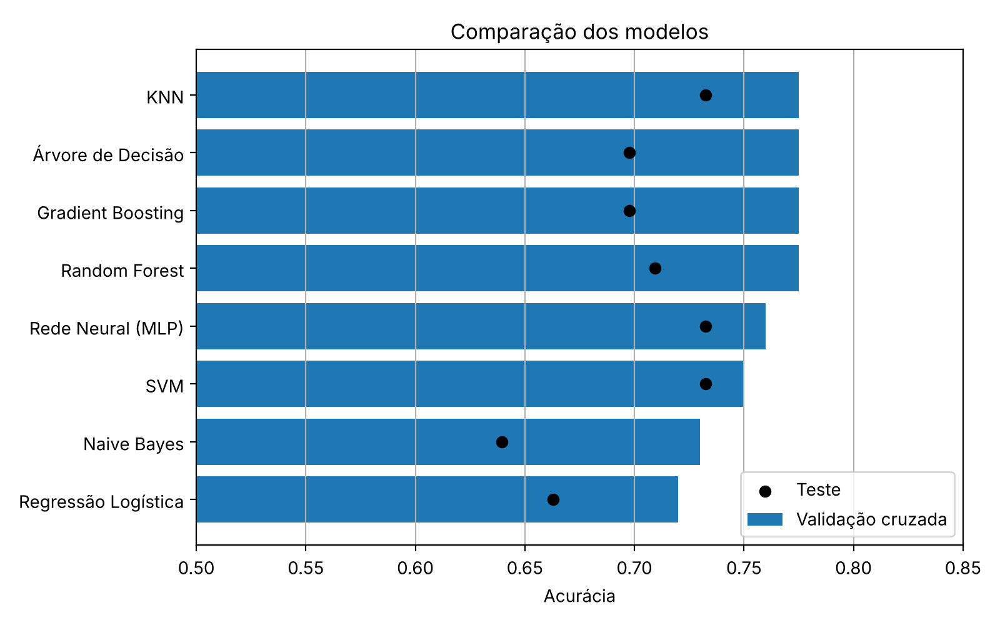
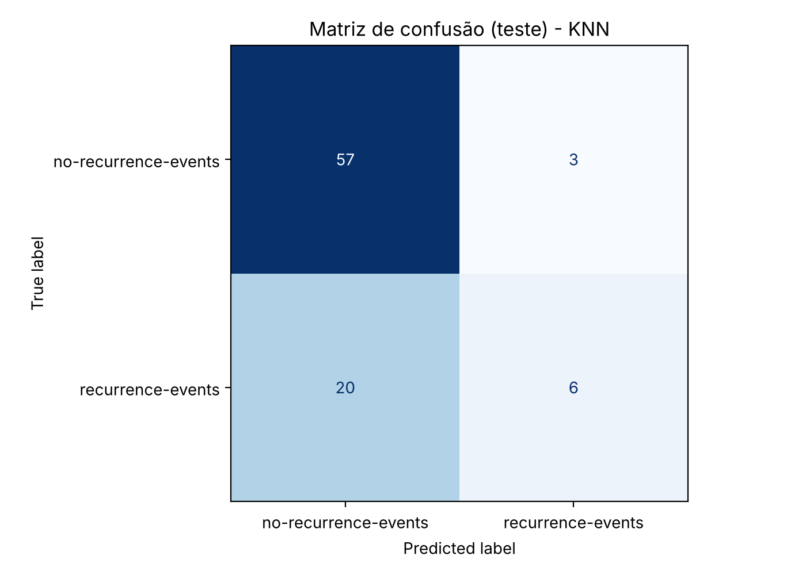

# Breast Cancer – Classificação de recorrência

Base de dados: [UCI Breast Cancer](https://archive.ics.uci.edu/dataset/14/breast+cancer) (286 pacientes, 9 atributos, classe `Class` = `no-recurrence-events` / `recurrence-events`).

## Arquivos

| Arquivo | Descrição |
|---|---|
| `breast-cancer.csv` | Base de dados |
| `breast_cancer_treinamento.py` | Módulo de treinamento |
| `breast_cancer_inferencia.py` | Módulo de inferência (nova paciente → indicativo de `Class`) |
| `normalizador_breast_cancer.model` | MinMaxScaler ajustado |
| `colunas_breast_cancer.model` | Colunas, dummies e modas usadas no pré-processamento |
| `breast_cancer_modelo.model` | Modelo final (melhor acurácia) |
| `resultados_modelos.csv` | Ranking de todos os modelos testados |
| `comparacao_modelos_breast_cancer.png` | Gráfico de acurácia dos modelos |
| `matriz_confusao_breast_cancer.png` | Matriz de confusão do melhor modelo no teste |

## Como executar

```bash
pip install -r requirements.txt
python breast_cancer_treinamento.py   # treina, compara e salva os .model
python breast_cancer_inferencia.py    # classifica a nova paciente definida no script
```

Para classificar outra paciente, altere o dicionário `nova_paciente` no início de `breast_cancer_inferencia.py`.

## Etapas do treinamento

1. **Leitura** da base e análise da distribuição das classes (201 × 85 – desbalanceada).
2. **Valores ausentes** (`?` em `node-caps` e `breast-quad`) substituídos pela moda.
3. **Pré-processamento**
   - Atributos em faixa (`age`, `tumor-size`, `inv-nodes`) convertidos para o ponto médio da faixa; `deg-malig` numérico. Todos normalizados com `MinMaxScaler`.
   - Atributos categóricos (`menopause`, `node-caps`, `breast`, `breast-quad`, `irradiat`) convertidos em dummies (`get_dummies`).
4. **Divisão treino/teste** 70/30 estratificada (normalizador ajustado só no treino).
5. **Balanceamento** com SMOTE, testado como hiperparâmetro (com e sem), aplicado apenas nas dobras de treino.
6. **Modelos + hiperparâmetros** com `GridSearchCV` e validação cruzada estratificada de 10 dobras, métrica = **acurácia**:
   Árvore de Decisão, Random Forest, Gradient Boosting, KNN, Naive Bayes, SVM, Regressão Logística e Rede Neural (MLP).
7. **Escolha do melhor modelo**: maior acurácia média na validação cruzada (empate → menor desvio padrão), avaliado no conjunto de teste.
8. **Modelo final** re-treinado com a base completa e salvo com `pickle`.

## Resultados

| Modelo | Acurácia CV | Desvio | Acurácia teste | SMOTE |
|---|---|---|---|---|
| **KNN** (k=7) | **0.775** | 0.068 | **0.733** | não |
| Árvore de Decisão | 0.775 | 0.078 | 0.698 | não |
| Gradient Boosting | 0.775 | 0.078 | 0.698 | não |
| Random Forest | 0.775 | 0.081 | 0.709 | não |
| Rede Neural (MLP) | 0.760 | 0.054 | 0.733 | não |
| SVM | 0.750 | 0.059 | 0.733 | não |
| Naive Bayes | 0.730 | 0.105 | 0.640 | não |
| Regressão Logística | 0.720 | 0.068 | 0.663 | sim |

Melhor modelo: **KNN (k = 7, pesos uniformes, sem balanceamento)** – 77,5% de acurácia na validação cruzada e 73,3% no teste.

Observação: como a classe majoritária representa ~70% da base, a busca por acurácia tende a favorecer `no-recurrence-events` (recall de `recurrence-events` no teste ≈ 23%).



